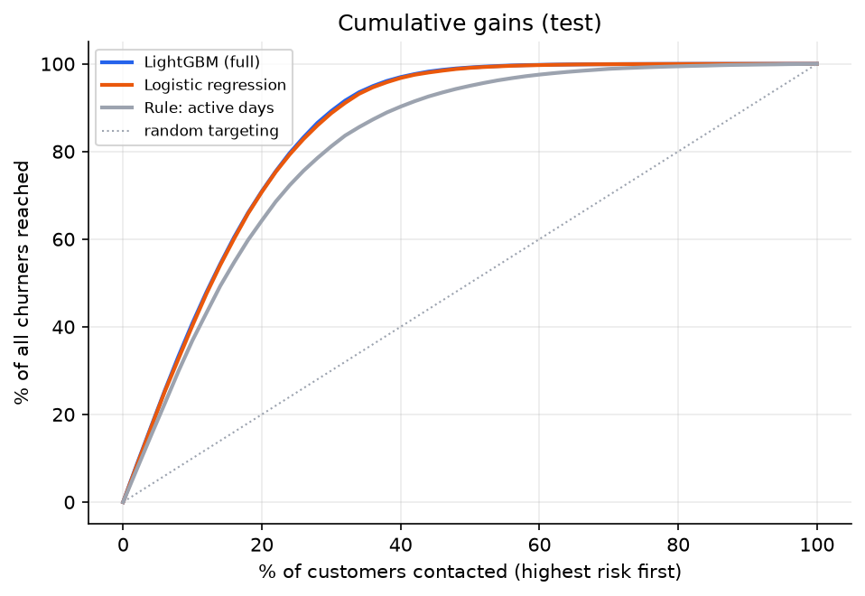
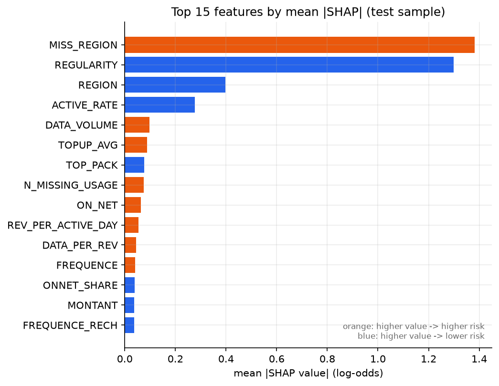

# Telecom Customer Churn Prediction — PySpark + LightGBM

Predicts which prepaid telecom customers will churn, ranks them by risk for a retention campaign, and explains the drivers
of risk with SHAP. Built on **2.15 million customers** from the Expresso Churn Prediction Challenge.

**Stack:** PySpark / Spark SQL · pandas · scikit-learn · LightGBM · SHAP · matplotlib

## Results

Held-out test set of **323,108 customers** (15%, never used for training, early stopping or threshold choice).

| Model | ROC-AUC | PR-AUC |
|---|---|---|
| Majority class (no model) | 0.500 | 0.188 |
| Logistic regression | 0.9295 | 0.6963 |
| LightGBM, raw features | 0.9313 | 0.7034 |
| **LightGBM, raw + engineered features** | **0.9314** | **0.7035** |

* At the threshold chosen on the validation set (0.34): **recall 81.8%**, precision 61.0%, F1 0.699.
* **Targeting:** the 10% of customers with the highest predicted risk contain **40.9%** of all churners (lift 4.1×);
  the top 20% contain **70.9%** (lift 3.5×).
* **Main drivers (SHAP):** whether the customer's region is recorded, number of active days, region, and data usage.
* The logistic-regression pipeline comes within 0.002 AUC of LightGBM, and the engineered features add almost nothing on
  top of the raw columns: the signal is dominated by activity and missing-value patterns, which both models capture.





## What the notebook does

1. **Spark SQL exploration** — churn rate, missing-value patterns, churn by activity and tenure.
2. **Row-level feature engineering in Spark** — activity rate, spend and recharge ratios, on-net share, tenure order,
   missing-value indicators (a missing `REVENUE` means *no spending*, which is a strong churn signal, so values are not
   mean-imputed).
3. **Leak-free evaluation** — stratified 70/15/15 train/validation/test split before any fitted transform; category
   grouping and imputation fitted on training data only; threshold chosen on validation; test set used once.
4. **Baselines** — majority class, a one-rule score, and a logistic-regression pipeline.
5. **LightGBM** with early stopping, plus an ablation (raw vs. engineered features).
6. **Business view** — cumulative gains and lift: how many churners a campaign reaches by contacting the top X%.
7. **Explainability** — TreeSHAP values computed by LightGBM.

Why not accuracy? About 19% of customers churn, so predicting "no churn" for everyone already scores 81% accuracy.
ROC-AUC, PR-AUC and lift measure whether the model actually separates churners from non-churners.

## How to run

**Requirements:** Python 3.10–3.12, Java 17 (for Spark), about 16 GB RAM.

```bash
git clone https://github.com/PanuwatC/<repo-name>.git
cd <repo-name>
python -m venv .venv && source .venv/bin/activate
pip install -r requirements.txt
```

**Data:** download `Train.csv` from the
[Expresso Churn Prediction Challenge](https://zindi.africa/competitions/expresso-churn-prediction) (or the Kaggle copy of
the same dataset) and place it at `data/Train.csv`. The data is not included in this repository.

**Run interactively:** open `churn_prediction.ipynb` in VS Code or Jupyter, select the `.venv` kernel, and *Run All*
(about 20–30 minutes on 4–8 CPU cores).

**Run on an HPC cluster (Slurm):**

```bash
sbatch run_slurm.sh      # executes the notebook headless and saves it with outputs
```

The notebook detects the Slurm allocation (`SLURM_CPUS_PER_TASK`, `SLURM_MEM_PER_NODE`) and sizes Spark and LightGBM
accordingly. If Spark cannot start (for example, Java is missing), it falls back to pandas and builds identical features.

## Outputs

| File | Content |
|---|---|
| `outputs/summary.txt` | headline numbers in plain text |
| `outputs/results.json` | every metric, gains table, top features, runtimes |
| `outputs/01_eda.png` … `05_shap_beeswarm.png` | figures |

## Limitations

* The data is a single snapshot without dates, so the split is random rather than time-based.
* The F1-maximising threshold is a neutral default; a real campaign would set it from offer cost and customer value, or
  contact a fixed top-X% of the ranking.

## Author

Panuwat Wasinanuwat — MSc Data Science, Chiang Mai University
